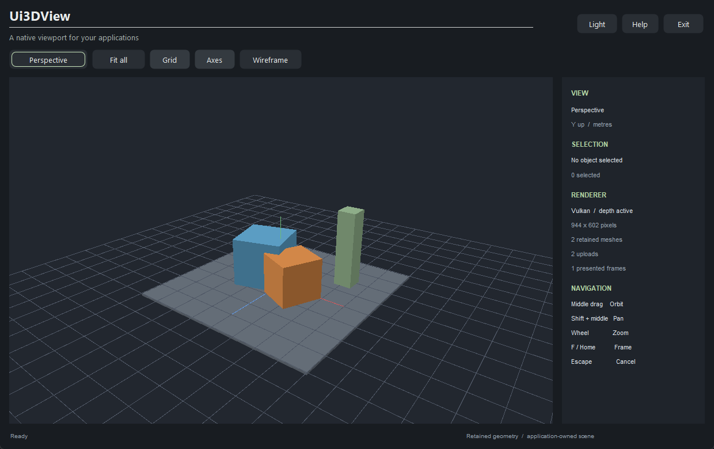

# Ui3DView validation and latest Release

Qualified on 1 November 2026 on DESKTOP-GFX1 through KlickCurt. The current owner
instruction selects the repository-level release directory.

## Latest executable

**`E:\apps\github\upp_render\bin\win64\Ui3DViewDemo.exe`**

Open it normally for the interactive demo. The binary is 6,193,664 bytes.
SHA-256: `eafbcbdd8078459bb1a59796ac06eddf24a74409a1fb1fee37c2ea5d6e8cdfc2`.

The exact Release executable was captured and tested under `build`, copied into
`bin/win64` with matching complete-file hashes, then successfully run from that
stable directory with `--smoke --validation`. This confirms the installed
location does not depend on the build directory. The stable-path run reported
one rendered frame, two mesh uploads, two retained meshes, one depth allocation
and no view error.

- [Architecture](UI3DVIEW_ARCHITECTURE.md)
- [Public API and integration guide](../render/Ui3DView/README.md)
- [Complete machine-readable evidence](UI3DVIEW_QUALIFICATION.json)

The implementation remains an uncommitted working-tree change based on
`b3a42b1ffe8830cb36c121add2b77d0e72fad465`. Unrelated staged gallery and
documentation work was preserved. The evidence JSON records exact source-file
and executable hashes; the shared tracked changes pass `git diff --check`.

## Completed test matrix

Every entry below exited zero. Counts are per execution, not a claim of distinct
coverage when the same suite is run in another configuration.

| Suite | Configuration | Observed result | Klick run |
| --- | --- | --- | --- |
| RenderSceneTest | Release | RenderSceneTest: 84 checks, 0 failures | `exec-258FE4E4EDAD8A62576E7C23ADD2AF96` |
| RenderSceneTest | Debug + BLITZ | RenderSceneTest: 84 checks, 0 failures | `exec-B9F8666E43B4AC5030CE7CF80E2DEFC6` |
| RenderVulkan3DTest | Release | RenderVulkan3DTest: 221 checks, 1928 oracle pixels, 0 failures | `exec-87399590A9DCA2DBDE263FE7CA4414EB` |
| RenderVulkan3DTest | Debug + BLITZ | RenderVulkan3DTest: 221 checks, 1928 oracle pixels, 0 failures | `exec-320392286B33F00E2D89E0A7C08B27A9` |
| Ui3DViewTest | Release | Ui3DViewTest PASS checks=116 failures=0 | `exec-97406850C0C8F7321209582BA8D4C454` |
| Ui3DViewTest | Debug | Ui3DViewTest PASS checks=116 failures=0 | `exec-2710D73AFF0E367CEEE07ED16D4D3AA2` |
| Ui3DViewTest | Debug + BLITZ | Ui3DViewTest PASS checks=116 failures=0 | `exec-129E0965FB73A62086D652139EFC16A6` |
| RenderRhiTest | Release | RenderRhiTest passed (193 checks) | `exec-951D186E2BB2E35E58B68209B1344770` |
| RenderVulkanGraphicsTest | Release | RenderVulkanGraphicsTest passed | `exec-2745A95CB6F6964254EF4307D7A8463C` |

The demo capture run is `exec-CC9B7C4E34CCD8A800A1EB80AD546426`; the stable-location smoke run is
`exec-AC0579A84361BE3610E01CE19FCA3A82`. Builds, output hashes, durations and earlier failed attempts
are retained in the evidence JSON.

## Reproducing the build

The qualified configuration uses U++ 18468, its clang x64 compiler, the local
`CLANGx64_Vulkan.bm` method and Vulkan SDK 1.4.350.0. It uses the existing
qualified Ui export rather than changing the independent Ui working tree.
Embedded shader headers were compiled with installed shaderc for Vulkan 1.1 /
SPIR-V 1.3; their source and generated hashes are included in the evidence.

PowerShell example for the Release demo:

```powershell
$ui3dNests = @(
    'E:/apps/github/upp_render/render',
    'E:/apps/github/upp_render/examples',
    'E:/apps/github/upp_render/tests',
    'E:/apps/github/upp_render/tools',
    'E:/apps/github/upp_render/build/qualified-ui-main-text',
    'E:/apps/github/upp_animation',
    'E:/upp-18468/uppsrc'
) -join ','
$ui3dMethod = 'E:/apps/github/upp_render/CLANGx64_Vulkan.bm'
& 'E:/upp-18468/umk.exe' $ui3dNests Ui3DViewDemo $ui3dMethod --out-dir 'E:/apps/github/upp_render/build/cache-ui3d-release' -rH4 '+GUI' 'E:/apps/github/upp_render/build/Ui3DViewDemo.exe'
if ($LASTEXITCODE -ne 0) { throw 'Ui3DViewDemo build failed' }
& 'E:/apps/github/upp_render/build/Ui3DViewDemo.exe' --capture --validation
if ($LASTEXITCODE -ne 0) { throw 'Ui3DViewDemo capture failed' }
```

Use the same nests/method for the listed test packages. Console suites use
`+CONSOLE`; Ui3DViewTest and the demo use `+GUI`. Ordinary Debug uses `-H4`
and `build/cache-ui3d-debug`; Debug with BLITZ uses `-bH4`. Native tests and
captures require an interactive Windows desktop. They refuse mouse injection or
foreground capture when their window does not own the required target.

For subsequent releases, build and run the qualification first, close any
running previous demo, then replace only `bin/win64/Ui3DViewDemo.exe` with the
tested executable and verify the source/destination SHA-256. Keep this stable
filename; compiler caches and test binaries stay under `build`.

## What the checks cover

### Immutable scene and camera

The CPU suite uses independent expected values for hierarchy composition,
inverse-transpose normals, projection/depth mapping and screen rays. It checks
perspective and orthographic projection, caller-array isolation, invalid meshes
and transforms, duplicate/missing/cyclic IDs, a 12,000-node hierarchy, nearest
triangle selection in both object orders, near-plane rejection and fit behavior.
Fit expands existing clipping only when necessary; dolly preserves authored
near/far planes.

### Vulkan mesh path

The finite 64 x 64 GPU suite compares 1,928 pixels against expected results.
Intersecting planes are submitted in both orders so success requires depth,
rather than an accidental painter's order. It checks 16/32-bit indices,
vertex bounds, graphics-parameter ranges and completeness, near/far clipping,
viewport orientation, mirrored winding/culling, analytically expected normal
lighting, depth clear/load/store, retained index-range cache invalidation and
unsubmitted-command discard. It requires an active validation layer and live
debug messenger, then asserts zero warnings/errors and zero final Vulkan-owned
resources.

A driver mapped-memory flush failure was not manufactured. Its defensive path
was source-reviewed: failed upload invalidates the CPU index mirror and cached
range maxima, because mapped memory may already have changed before flush fails.
Uncertain submitted work cannot be discarded or replayed.

### Native control

The native suite opens actual U++ windows with two controls. Bounded Win32
SendInput mouse presses and moves exercise selection, middle navigation,
rapid repeated presses, capture/focus cancellation, rebinding, callback-driven
destruction and close/reopen behavior. Movement waits for observed delivery and
checks its coordinates. Foreground/window hit guards prevent silently sending
the test input to another application.

An initial ordinary Debug run failed the foreground guard before early input
injection. The helper now waits for observed activation (up to 500 ms) and for
the requested motion coordinates; it still refuses input if activation is denied.
An updated Release attempt was also denied foreground access; one bounded
manual recheck then passed. These failed attempts remain in the evidence. The
wait improves asynchronous activation handling; it does not promise or force
foreground ownership on an actively used Windows desktop.

The suite also checks retained uploads during camera changes, no idle render
loop, scene/camera/binding/view/size identity for pick freshness, invalid setters,
disable/hide, zero-size restoration and complete final resource cleanup.
Escape and disabled-wheel cases use direct handlers; this is not a claim that
every keyboard shortcut has been exercised through physical key input.

### Existing contracts

RenderRhiTest retains its existing neutral/Null lifecycle tests and adds explicit
unsupported-3D/default-value checks. RenderVulkanGraphicsTest remains the
established color-only graphics, upload, swapchain/resize, validation and
ownership regression. Its existing pass output does not include a check count.

## Findings fixed during implementation

| Finding | Resolution |
| --- | --- |
| The native DHCtrl host could consume input intended for the owning control | Keep the native HWND disabled according to U++ routing and forward host mouse events once, with destruction-aware access |
| U++ middle double/triple events do not automatically forward to MiddleDown | Ui3DView explicitly forwards those presses; the native regression includes rapid repeated presses |
| Fixed-delay cursor movement did not prove that navigation received a move | The test injects an absolute native move and observes delivered coordinates before assessing camera change |
| U++ still accesses its captured Ctrl after CancelMode returns | Restore control state immediately, defer the copied cancellation callback, and flush it before newer semantic input |
| Stale results could share an application revision or object ID | Picks carry originating-view identity, scene binding, camera revision and viewport size |
| Rebinding or a cancellation callback could replace/destroy the current view | Callbacks receive value payloads; guarded continuation and binding generations let newer application changes win |
| Fitting could unnecessarily tighten the camera's useful clipping range | Fit expands clip planes only; subsequent dolly preserves authored limits |
| Depth/index/parameter contracts were missing from the renderer | Implemented complete neutral and Vulkan paths, validation, ownership and failure behavior |
| Repeated attachment writes and abandoned commands could publish incorrect texture state | Explicit same-layout dependencies and pending state committed only after successful submission |
| Index validation could rescan retained geometry every frame | Bounded cached range maxima, invalidated by writes and failed native uploads |
| BLITZ combined private helper names from two existing 2D source files | Mark GpuVectorRasterizer.cpp as NOBLITZ in RenderGpu2D.upp; retain normal per-file scope without changing rasterizer algorithms |

The initial Debug+BLITZ failure is retained in the machine-readable evidence.
Its diagnostic named MAX_POINTS, EPS and Finite collisions between
RenderGpu2DPath.cpp and GpuVectorRasterizer.cpp. The package-specific exclusion
uses the U++ package parser's supported BUILDER_OPTION NOBLITZ setting.

## Visual inspection

The bounded demo capture run rendered a fresh frame for each of dark, light,
wireframe and orthographic modes. It reported four frames, two mesh uploads,
two retained meshes, one depth allocation and no view error. All four 1240 x 780
client captures were read back and inspected. Geometry, depth overlap, grid,
projection changes, toolbar labels and the diagnostics/navigation panel are
visible; there are no blank viewport captures or cropped main controls at this
tested size.

- [Dark perspective](ui3dview-captures/Ui3DView-dark.png)
- [Light perspective](ui3dview-captures/Ui3DView-light.png)
- [Wireframe](ui3dview-captures/Ui3DView-wireframe.png)
- [Orthographic](ui3dview-captures/Ui3DView-orthographic.png)



## Supported scope and remaining qualification

This is the first reusable opaque, untextured mesh viewport. It supports
camera navigation, fit, geometric selection requests, hierarchy, retained
geometry, basic lighting, grid/axes and perspective/orthographic/wireframe
presentation. The application owns the document, accepted selection, undo,
imports, evaluated animation and time.

Current boundaries are intentional and documented in the API guide:

- CPU triangle picking is linear within candidate meshes. Nonselectable objects
  do not occlude selectable objects; wireframe still uses solid-triangle picking.
- Selection IDs survive scene replacement. Apps must republish/clear selection
  when changing documents, particularly if IDs are reused. FitSelection uses
  selected objects' own mesh bounds; group descendants are application policy.
- GPU geometry/parameters use float32 although CPU math uses doubles. Validation
  bounds are not a large-world accuracy or interactive-performance guarantee.
  Locally centred geometry is recommended; rebasing/precision qualification is
  future work.
- Graphics parameters are 0 or 4..128 bytes in multiples of four. Index buffers
  are host-visible, non-storage and at most 64 MiB, with a complete first upload.
  D32F is attachment-only; depth sampling/readback/stencil are not implemented.
- Presentation uses the existing synchronous GpuCtrl path. There is no idle
  animation clock, measured frame-rate guarantee or claimed asynchronous worker.
- Physical mouse/keyboard feel, monitor scaling, cross-monitor DPI transitions
  and additional GPU/driver combinations remain owner acceptance work.
- Device-loss/driver-failure injection, long-duration soak and GPU performance
  benchmarking are not claimed. Checks were bounded and serialized; the handoff
  recorded an earlier host blackout, so no sustained stress loop was introduced.

The next separately scoped additions should follow application needs:
transform gizmos and document edit transactions; BVH acceleration after profiling
representative scenes; materials/textures/transparency; viewport antialiasing;
evaluated deformation/skinning; depth/normal/ID export; and large-world rebasing.
The public control remains independent of those application-specific features.
